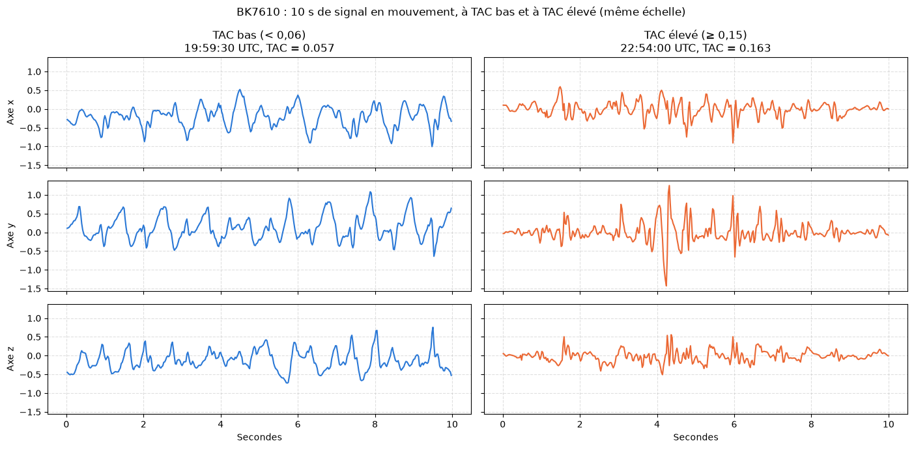
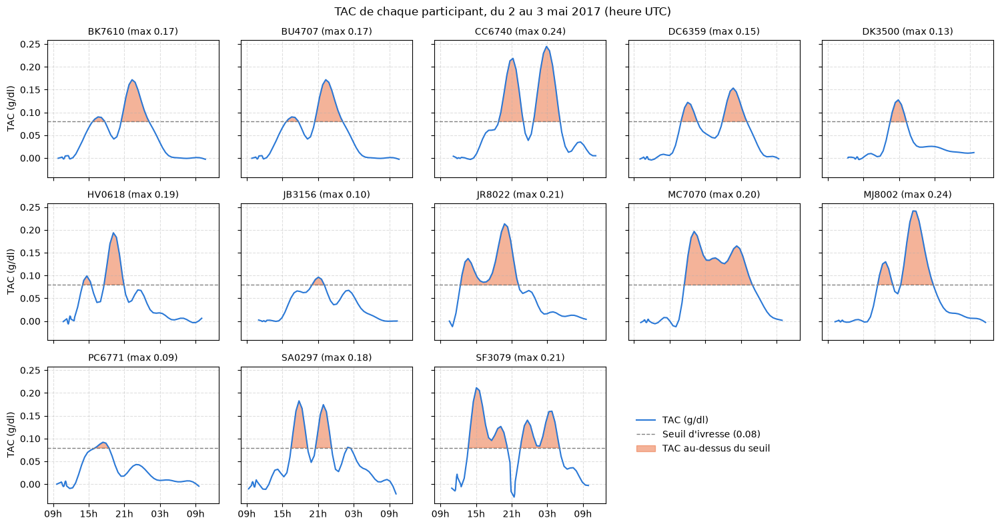
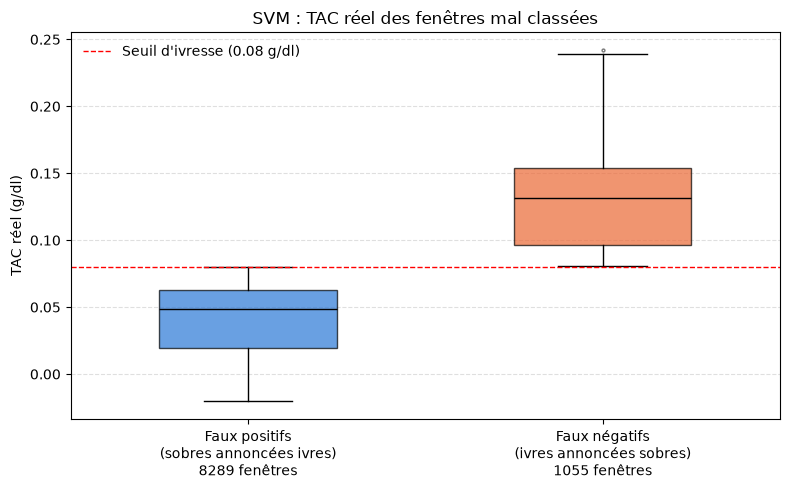

<h1 align="center">🍻 Détecter l'ivresse à partir de l'accéléromètre d'un smartphone</h1>

<p align="center">
  <em>10 secondes de mouvement suffisent-elles pour savoir si quelqu'un a dépassé 0,08 g/dl ?</em>
</p>

<p align="center">
  
  
  
  
  
</p>

---

## Contexte

Les épisodes d'alcoolisation massive exposent à des risques immédiats : accidents, comportements dangereux. Les interventions mobiles « juste à temps » supposent de détecter l'ivresse au moment où elle survient, sans action de l'utilisateur. Le smartphone, porté en permanence, offre pour cela un capteur passif : l'accéléromètre.

**Problématique.** Peut-on détecter, à partir de 10 secondes de signal d'accéléromètre, qu'une personne dépasse le seuil d'alcoolémie de 0,08 g/dl ?

**Hypothèse.** L'alcool altère la coordination motrice (équilibre, régularité de la marche). Cette altération doit laisser une trace dans le signal, au-delà du simple niveau d'activité.

<p align="center">
  
  <br />
  <sub>Même participant, même amplitude : un mouvement régulier à TAC bas, des à-coups à TAC élevé.</sub>
</p>

## Jeu de données

- **13 participants** suivis pendant une tournée des bars (mai 2017), sur environ 24 heures.
- **Accéléromètre du téléphone** (11 iPhone, 2 Android), annoncé à 40 Hz : 14 millions de mesures.
- **TAC** (*transdermal alcohol content*) : bracelet de cheville SCRAM, une mesure toutes les 30 minutes environ.
- **Cible** : état d'ivresse si TAC ≥ 0,08 g/dl.

<p align="center">
  
</p>

L'article de référence, Killian et al. (2019), atteint 77,5 % d'accuracy avec une forêt aléatoire.

## Démarche

1. **Exploration** : qualité, couverture et cohérence des deux sources. Elle a révélé une panne de capteur, un fichier d'alcoolémie identique pour deux participants et des téléphones échantillonnant entre 22 et 50 Hz.
2. **Feature engineering** : nettoyage, découpage en 26 306 fenêtres de 10 s étiquetées, 56 features (intensité, forme, régularité du signal, contexte des 5 dernières minutes), normalisées par participant.
3. **Apprentissage** : comparaison de quatre modèles, chacun évalué sur un participant qu'il n'a jamais vu, face à une référence fondée sur l'activité seule.
4. **Réglage des hyperparamètres**, puis analyse des erreurs.

## Résultats

| Modèle | AUROC | Exactitude équilibrée | Précision | Rappel |
|---|---|---|---|---|
| **SVM (retenu)** | **0,762** | **70,9 %** | 44,3 % | 86,2 % |
| Forêt aléatoire | 0,762 | 70,0 % | 45,8 % | 77,8 % |
| Gradient boosting | 0,753 | 68,2 % | 48,3 % | 64,6 % |
| Régression logistique | 0,662 | 67,0 % | 45,3 % | 67,2 % |
| Référence : activité seule | 0,625 | 61,2 % | 38,9 % | 63,0 % |

Après un nettoyage complet du jeu de données, la construction de variables caractérisant l'intensité, la forme et la régularité des signaux, ainsi que la comparaison de quatre modèles par validation croisée, le SVM s'impose comme le meilleur algorithme. Il atteint une AUROC de 76 % et une exactitude équilibrée de 71 %.

Cependant, ces résultats globaux masquent une limite majeure : la précision du modèle plafonne à 44 %, ce qui signifie que plus d'une alerte d'ivresse sur deux est un faux positif. La séparation s'appuie presque exclusivement sur le niveau d'activité globale de l'utilisateur, et aucun modèle ne parvient à faire mieux que ce simple indicateur pour suivre une personne donnée. En l'état, ces performances restent trop fragiles pour un contexte social ou juridique comme un contrôle d'alcoolémie, où le coût d'une fausse accusation est inacceptable. Pour des applications de santé mobile, l'outil ne pourrait servir qu'à titre indicatif, en combinant plusieurs prédictions sur 1 à 2 minutes pour stabiliser la décision.

<p align="center">
  
  <br />
  <sub>Les erreurs ne se limitent pas aux fenêtres proches du seuil : beaucoup sont des cas francs.</sub>
</p>

##  Limites et pistes

Ce manque de précision s'explique en grande partie par la qualité et la structure des données. Sur les 19 participants initiaux, seuls 12 présentaient des enregistrements exploitables, et seulement 8 ont effectivement alterné entre sobriété et ivresse au cours du suivi. La position du téléphone (poche, sac, main ou table) et son orientation étaient inconnues, ce qui empêche d'associer les axes d'accélération à une direction de déplacement.

Pistes :

- imposer un capteur unique pour tous les sujets ;
- isoler la marche réelle via les algorithmes natifs du téléphone ;
- ajuster le seuil de décision selon le cas d'usage ;
- collecter davantage de données, avec une période sobre de référence pour chaque individu ;
- tester les coefficients MFCC, principal gain de la littérature, sous une validation stricte par participant ;
- appliquer des réseaux convolutifs ou récurrents directement au signal brut, à condition de disposer de beaucoup plus de participants.

Deux limites de méthode à garder en tête : la normalisation par participant utilise toute sa session, donc elle n'est pas utilisable telle quelle en temps réel, et les hyperparamètres sont réglés sur les mêmes participants que l'évaluation, ce qui rend les scores légèrement optimistes.

## Lancer le notebook

Prérequis : Python 3.13 (version utilisée ; les versions récentes de pandas demandent au moins 3.11).

```bash
git clone https://github.com/bastaga15/bar-crawl-heavy-drinking.git
cd bar-crawl-heavy-drinking
python -m venv .venv
source .venv/bin/activate        # Windows : .venv\Scripts\activate
pip install -r requirements.txt
```

**Données.** Le jeu de données (150 Mo compressé, 660 Mo décompressé) n'est pas inclus. Téléchargez `data.zip` sur la page [Bar Crawl: Detecting Heavy Drinking](https://archive.ics.uci.edu/dataset/515/bar+crawl+detecting+heavy+drinking) de l'UCI, puis décompressez-le dans un dossier `data/` à la racine :

```
data/
  all_accelerometer_data_pids_13.csv
  phone_types.csv
  pids.txt
  clean_tac/
  raw_tac/
```

Sur Google Colab, le notebook lit les données dans `MyDrive/data/` après avoir monté le Drive.

```bash
jupyter notebook BarCrawlDetectingHeavyDrinking.ipynb
```

Puis « Restart & Run All ». Les grilles de réglage du SVM et de la forêt aléatoire sont les étapes les plus longues.

## 📚 Références

- Killian, J. A., Passino, K. M., Nandi, A., Madden, D. R. et Clapp, J. (2019). *Learning to Detect Heavy Drinking Episodes Using Smartphone Accelerometer Data.* KDH workshop, IJCAI 2019. [PDF](http://ceur-ws.org/Vol-2429/paper6.pdf)
- Jeu de données : Killian, J., Madden, D. et Clapp, J. *Bar Crawl: Detecting Heavy Drinking*, UCI Machine Learning Repository, [doi:10.24432/C5TK6G](https://doi.org/10.24432/C5TK6G), licence CC BY 4.0.

## 📄 Licence

Code sous licence MIT (voir `LICENSE`). Les données appartiennent à leurs auteurs et sont diffusées par l'UCI sous licence CC BY 4.0.

---

<p align="center">
  Projet réalisé dans le cadre du cursus de l'ISAE-SUPAERO par <strong>Bastien Lechat</strong>, <a href="https://lectech.fr">LecTech</a>
</p>
